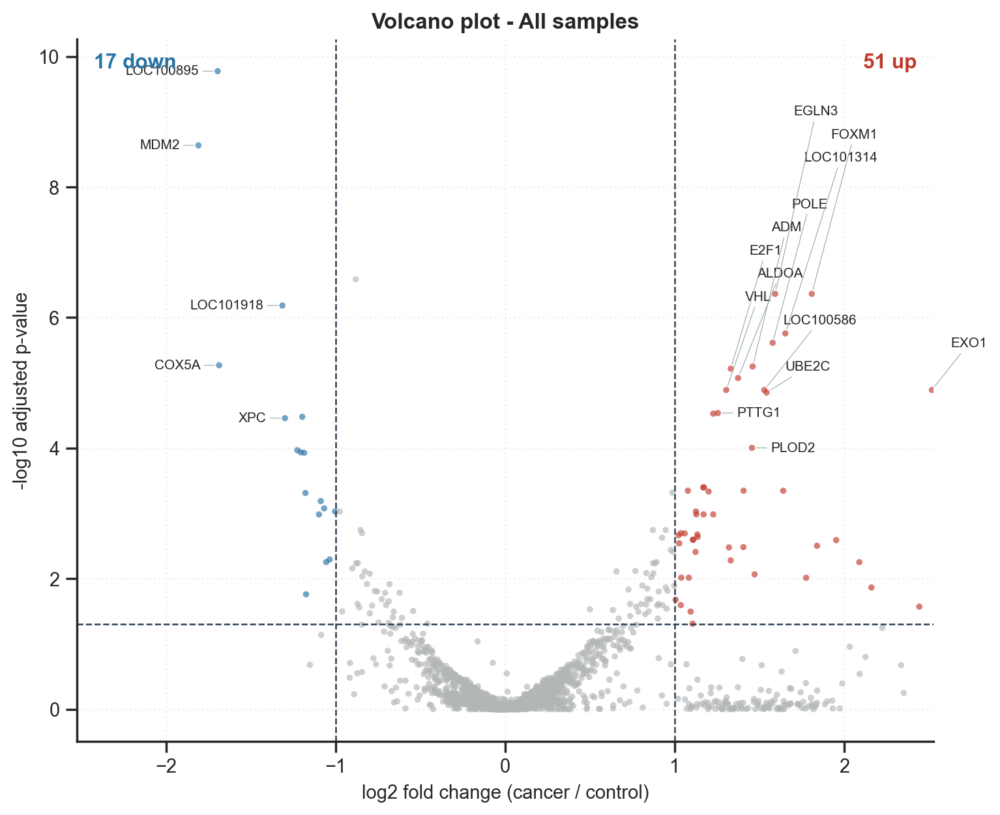
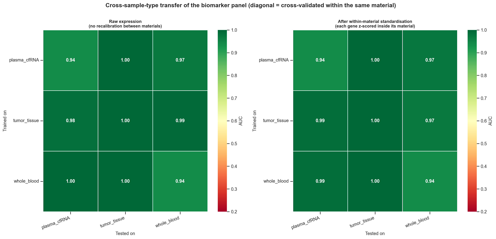

# RNA-seq Cancer vs Control Biomarker Pipeline

A reproducible, Python-only transcriptomics pipeline that takes raw RNA-seq
counts for cancer and control samples and produces a **ranked biomarker panel
compared across sample types**. It was developed to integrate tumour-tissue
and liquid-biopsy (plasma EV-RNA / cell-free RNA, whole blood) transcriptomes
in colorectal cancer, and works for any two-group design with one or more
sample types.

One command produces ~70 figures, ~20 result tables and a single
self-contained HTML report.


## Table of Contents

- [1. Overview](#1-overview)
- [2. Getting the Pipeline](#2-getting-the-pipeline)
- [3. Repository Structure](#3-repository-structure)
- [4. Installation](#4-installation)
- [5. Quick Start with the Bundled Example](#5-quick-start-with-the-bundled-example)
- [6. Input Data](#6-input-data)
- [7. Configuration and Command-Line Options](#7-configuration-and-command-line-options)
- [8. Analysis Workflow](#8-analysis-workflow)
- [9. Statistical Methods](#9-statistical-methods)
- [10. Results Structure](#10-results-structure)
- [11. Result Interpretation](#11-result-interpretation)
- [12. Example Results](#12-example-results)
- [13. Reproducibility](#13-reproducibility)
- [14. Limitations](#14-limitations)
- [15. Citation](#15-citation)
- [16. License](#16-license)
- [17. Authors / Contact](#17-authors--contact)

## 1. Overview

**What the pipeline does.** Starting from one count file per sample (or a
single merged count matrix) plus a sample sheet, the pipeline runs quality
control, differential expression (DE), a cross-sample-type comparison,
biomarker discovery with honest validation, and functional enrichment, then
collects everything into `results/report.html`.

**Why sample types matter.** Cancer signals look different in solid tumour
tissue than in plasma or blood, where the tumour contribution is diluted by a
large background of normal transcripts. The pipeline therefore runs every
contrast **within each sample type** as well as on the pooled data, tests the
condition × sample-type interaction, and asks whether a biomarker panel
trained on one material still works on another.

**Statistics engine.** Differential expression uses
[PyDESeq2](https://github.com/owkin/PyDESeq2), a Python implementation of
DESeq2's negative-binomial model. If PyDESeq2 is not installed, the pipeline
falls back to a Welch t-test on log2 CPM, so it never hard-fails.

## 2. Getting the Pipeline

```bash
git clone https://github.com/dorsahayati/RNAseq-data-analysis-pipeline.git
cd RNAseq-data-analysis-pipeline
```

No large files or Git LFS are needed; the bundled example data and its
results are plain text and images.

## 3. Repository Structure

```text
RNAseq-data-analysis-pipeline/
├── rnaseq_bm/                    # Pipeline package
│   ├── pipeline.py               # End-to-end orchestration (counts in, report out)
│   ├── config.py                 # YAML config loading and defaults
│   ├── io_counts.py              # Count-file / matrix / sample-sheet readers and validation
│   ├── normalize.py              # Gene filtering, DESeq/TMM/CPM normalisation, VST, TPM
│   ├── de.py                     # PyDESeq2 Wald test, t-test fallback, interaction test
│   ├── compare.py                # Cross-sample-type overlap, concordance, Stouffer meta-analysis
│   ├── biomarkers.py             # ROC/AUC, panel selection, CV, nested CV, permutation, transfer
│   ├── enrichment.py             # Offline ORA and pre-ranked GSEA, optional Enrichr
│   ├── figures_qc.py             # Quality-control figures
│   ├── figures_de.py             # Differential-expression figures
│   ├── figures_biomarker.py      # Biomarker figures
│   ├── plotting.py               # Shared plotting style and figure bookkeeping
│   ├── report.py                 # Self-contained HTML report
│   └── utils.py                  # Logging, seeding, I/O helpers
├── resources/
│   └── hallmark_lite.gmt         # Small demonstration gene-set collection
├── test_data/                    # Simulated example dataset (80 samples, 3 sample types)
├── test_results/                 # Pipeline output on test_data (per-sample file mode)
├── test_results_matrix_check/    # Pipeline output on test_data (merged-matrix mode)
├── run_pipeline.py               # Command-line entry point
├── make_example_data.py          # Simulator that generates the example dataset
├── config.yaml                   # Fully commented configuration file
├── requirements.txt              # pip dependencies
├── environment.yml               # Conda environment
└── LICENSE
```

## 4. Installation

Python 3.9 or newer is required (tested on 3.9–3.12).

### Option A: pip + virtual environment

```bash
python -m venv .venv
source .venv/bin/activate        # Windows: .venv\Scripts\activate
pip install -r requirements.txt
```

Optional extras: `pip install gseapy umap-learn` (Enrichr queries and a UMAP
panel in the QC embeddings figure).

### Option B: Conda

```bash
conda env create -f environment.yml
conda activate rnaseq-biomarker
```

The Conda environment uses Python 3.11 and already includes the optional
extras.

## 5. Quick Start with the Bundled Example

`test_data/` holds a simulated dataset: 80 samples across three sample types
(tumour tissue 12 + 12, plasma cfRNA 14 + 14, whole blood 14 + 14), 4,000
genes, negative-binomial counts with a batch effect and a shared cancer
signature that is progressively diluted in the liquid biopsies.

`config.yaml` reads from `data/`, so the shortest way to run the example is
to copy the bundled data there (`data/` is git-ignored):

```bash
cp -r test_data data
python run_pipeline.py --config config.yaml
```

Then open `results/report.html`.

To run the same data in merged-matrix mode instead:

```bash
python run_pipeline.py -c config.yaml --counts-matrix data/counts_matrix.tsv -o results_matrix
```

You can also regenerate the dataset from scratch (optionally with a
different seed or gene count):

```bash
python make_example_data.py --outdir data --seed 7 --n-genes 4000
```

`simulation_truth.csv` contains the true fold changes, so you can benchmark
the pipeline's calls against the ground truth. Precomputed outputs are in
`test_results/` and `test_results_matrix_check/`; open
`test_results/report.html` to see a full report without running anything.

## 6. Input Data

### 6.1 Counts — two input modes

**Mode A — one count file per sample.** Put the files in a folder and set
`input.counts_dir`. These formats are auto-detected:

```text
featureCounts   # Geneid  Chr  Start  End  Strand  Length  <bam>
htseq-count     # ENSG00000141510	1523        (no header, __no_feature rows dropped)
STAR            # <sample>ReadsPerGene.out.tab   (unstranded column used, N_* rows dropped)
RSEM / salmon   # gene_id ... expected_count / NumReads
generic         # gene_id,count
```

The sample id is the file name with the extension stripped
(`TUMOR_01.counts.txt` → `TUMOR_01`) and must match the sample sheet.

**Mode B — one merged matrix**, genes in rows and samples in columns. Set
`input.counts_matrix` and leave `input.counts_dir: null`:

```text
gene_id           gene_name  Length  TUMOR_01  TUMOR_02  PLASMA_01
ENSG00000141510   TP53       2591    1420      1655      310
ENSG00000012048   BRCA1      5589    880       931       142
```

Only the gene column and the sample columns are required. `.csv`, `.tsv`,
`.txt` (optionally `.gz`) and `.xlsx` all work: the delimiter is sniffed,
leading `#` comment lines are skipped, and annotation columns are separated
from sample columns automatically:

- `gene_name` / `symbol` / `hgnc_symbol` → used to label genes in every
  figure, so no separate annotation file is needed.
- `Length` → enables TPM export.
- `Chr`, `Start`, `End`, `Strand`, `biotype` and other non-numeric columns →
  ignored with a warning.

Duplicate gene ids are summed and Ensembl version suffixes are stripped by
default (`ENSG00000141510.16` → `ENSG00000141510`).

> **Use raw integer counts** in either mode, not TPM/FPKM/normalised values —
> the negative-binomial model needs them. The pipeline warns if most values
> are not whole numbers.

### 6.2 Sample sheet

```csv
sample_id,condition,sample_type,batch,age,sex
TUMOR_01,cancer,tumor_tissue,B1,64,F
TUMOR_02,control,tumor_tissue,B1,59,M
PLASMA_01,cancer,plasma_cfRNA,B2,71,M
```

- `condition` — must contain exactly the two labels set in
  `input.case_label` / `input.control_label`.
- `sample_type` — the column driving the cross-material comparison. It can be
  specimen type, tumour subtype, stage or site. Set `sample_type_col: null`
  to skip that section.
- `batch` — added to the DE design automatically unless it is confounded with
  condition, in which case it is dropped with a warning.

### 6.3 Optional annotation files

- `input.gene_annotation` — a `gene_id → gene_name` table; takes precedence
  over symbols embedded in the count matrix.
- `input.gene_lengths` — gene lengths for TPM when the counts do not carry a
  `Length` column.

## 7. Configuration and Command-Line Options

All options live in `config.yaml`, which is fully commented. Paths are
resolved relative to the folder containing the config file. The main
sections are `project`, `input`, `filtering`, `analysis`, `biomarkers`,
`enrichment`, `plots` and `report`.

Common options can be overridden from the command line without editing the
file:

| Flag | Overrides | Description |
|---|---|---|
| `-c`, `--config` | — | YAML configuration file (default `config.yaml`) |
| `--counts` | `input.counts` | A matrix file **or** a folder of per-sample files (auto-detected) |
| `--counts-dir` | `input.counts_dir` | Folder of per-sample count files |
| `--counts-matrix` | `input.counts_matrix` | Single genes × samples matrix |
| `-m`, `--metadata` | `input.metadata` | Sample sheet |
| `-o`, `--outdir` | `project.outdir` | Output folder |
| `--de-method` | `analysis.de_method` | `auto`, `pydeseq2` or `ttest` |
| `--alpha` | `analysis.alpha` | FDR threshold |
| `--lfc` | `analysis.lfc_threshold` | Minimum absolute log2 fold change |
| `--panel-size` | `biomarkers.panel_size` | Genes in the biomarker panel |
| `--permutations` | `biomarkers.permutations` | Label permutations for the panel null |
| `--no-enrichment` | `enrichment.enable` | Skip functional enrichment |
| `--online-enrichment` | `enrichment.online` | Also query Enrichr (needs internet + gseapy) |
| `--seed` | `project.seed` | Random seed |

Naming one count input on the command line clears the others. If both a
matrix and a folder are set in the config, the matrix wins and the log says
so.

```bash
python run_pipeline.py -c config.yaml --counts /data/counts -o results_v2
python run_pipeline.py -c config.yaml --alpha 0.01 --lfc 1.5 --panel-size 10
python run_pipeline.py -c config.yaml --de-method ttest --no-enrichment
```

## 8. Analysis Workflow

```text
Count files / count matrix  +  sample sheet
   ↓
1. Input        merge, annotate, validate against the sample sheet
   ↓
2. QC           filtering, normalisation (DESeq / TMM / CPM), VST, PCA, clustering, outliers
   ↓
3. DE           all samples + each sample type separately + condition × sample-type interaction
   ↓
4. Comparison   overlaps, fold-change concordance, Stouffer meta-analysis, core markers
   ↓
5. Biomarkers   per-gene ROC/AUC, panel selection, 3 classifiers, CV, nested CV,
                permutation null, cross-material transfer, signature score
   ↓
6. Enrichment   offline ORA + pre-ranked GSEA, pathway activity per sample type
   ↓
7. Report       results/report.html with every figure, caption and key table
```

| Stage | Output |
|---|---|
| **1. Input** | One count file per sample (featureCounts, htseq-count, STAR, RSEM/salmon, generic) **or** a single genes × samples matrix, merged, annotated and validated. |
| **2. QC** | Library size, gene detection, sparsity, RLE, size factors, mean–variance trend, correlation and distance heatmaps, dendrogram, PCA (+ factor-association test), t-SNE/MDS/UMAP, outlier scores. |
| **3. Differential expression** | DESeq2-equivalent Wald test with LFC shrinkage on all samples and within each sample type, plus an interaction test. Volcano, MA, dispersion, p-value histograms, heatmaps, per-gene boxplots. |
| **4. Sample-type comparison** | Venn / UpSet overlaps, pairwise fold-change concordance, Jaccard and rank-concordance curves, Stouffer meta-analysis, forest plots, shared-vs-specific breakdown. |
| **5. Biomarkers** | Per-gene AUC with bootstrap CIs and AUC per sample type, redundancy-aware panel selection, L1 logistic regression / random forest / RBF-SVM with repeated CV, nested CV, permutation test, panel-size curve, train-on-one-material / test-on-another transfer matrix, composite signature score. |
| **6. Enrichment** | Offline over-representation and pre-ranked GSEA (permutation NES + running-score plots), pathway activity compared across sample types, optional Enrichr. |
| **7. Report** | Single self-contained HTML file with all figures, captions, headline metrics and key tables. |

## 9. Statistical Methods

**Differential expression.** DESeq2 median-of-ratios normalisation,
gene-wise dispersion shrunk towards a fitted trend, Wald test,
Benjamini–Hochberg FDR, and apeglm-style shrinkage of fold changes so
low-count genes do not dominate the rankings. Default thresholds: FDR < 0.05
and |log2 FC| ≥ 1.

**Per-sample-type contrasts.** Each sample type is tested separately rather
than pooled, because pooling assumes the cancer effect has the same size in
every material. The interaction test reports the genes where that assumption
fails.

**Combining sample types.** Stouffer's weighted Z, weighted by √n. A *core
marker* is significant in every sample type, moves in the same direction in
all of them, and survives the combined FDR.

**Biomarker performance is reported three ways**, because the first is
optimistic on its own:

1. Cross-validated AUC of a panel chosen on all samples — what most papers
   report.
2. **Nested CV**, where gene selection is repeated inside every training
   fold — the honest estimate.
3. A **label-permutation null**, showing the AUC the pipeline reports on data
   with no signal.

The report raises a warning when 1 and 2 differ by more than 0.08.

**Cross-material transfer.** Expression is z-scored within each sample type
before the transfer experiment, so the matrix measures whether marker
*behaviour* carries over rather than the large baseline differences between
tissue, plasma and blood.

## 10. Results Structure

```text
results/
├── report.html                          <- start here (self-contained)
├── pipeline.log
├── figures/
│   ├── figure_index.csv                 <- every figure with its caption
│   ├── 01_quality_control/              (19 figures, png + pdf)
│   ├── 02_differential_expression/      (22)
│   ├── 03_sample_type_comparison/       (11)
│   ├── 04_biomarkers/                   (14)
│   └── 05_enrichment/                   (4)
└── tables/
    ├── de_all_samples.csv
    ├── de_<sample_type>.csv
    ├── de_summary.csv
    ├── de_condition_by_sample_type_interaction.csv
    ├── cross_sample_type_meta_analysis.csv
    ├── sample_type_concordance.csv
    ├── biomarker_univariate_performance.csv
    ├── biomarker_panel_summary.csv
    ├── biomarker_cross_sample_type_transfer_auc.csv
    ├── biomarker_sample_scores.csv
    ├── enrichment_*.csv
    ├── normalised_counts.csv / vst_expression.csv / tpm_expression.csv
    └── sample_qc_metrics.csv / pca_coordinates.csv
```

## 11. Result Interpretation

- **`report.html`** — the full analysis in one file; open this first.
- **`de_all_samples.csv`, `de_<sample_type>.csv`** — every tested gene with
  base mean, (shrunken) log2 fold change, p-value and adjusted p-value.
- **`de_summary.csv`** — number of significant up/down genes per contrast,
  method used and covariates included.
- **`de_condition_by_sample_type_interaction.csv`** — genes whose cancer
  effect differs between sample types.
- **`cross_sample_type_meta_analysis.csv`** — Stouffer combined statistics
  and the core-marker flag.
- **`biomarker_univariate_performance.csv`** — AUC (with bootstrap CI) per
  gene, overall and per sample type.
- **`biomarker_panel_summary.csv`** — per classifier: CV AUC, nested-CV AUC,
  permutation p-value, accuracy, sensitivity/specificity at the Youden
  threshold.
- **`biomarker_cross_sample_type_transfer_auc.csv`** — AUC when training on
  one material and testing on another.
- **`figures/figure_index.csv`** — lists every figure with its caption.

## 12. Example Results

On the bundled simulated dataset (`test_results/`), PyDESeq2 with batch as a
covariate found:

| Contrast | Cancer / Control | Genes tested | Significant | Up | Down |
|---|---|---|---|---|---|
| All samples | 40 / 40 | 3,708 | 68 | 51 | 17 |
| Tumour tissue | 12 / 12 | 3,708 | 154 | 115 | 39 |
| Plasma cfRNA | 14 / 14 | 3,708 | 33 | 15 | 18 |
| Whole blood | 14 / 14 | 3,708 | 38 | 25 | 13 |

The 15-gene panel reached a cross-validated AUC of 0.975–0.986 and a nested
CV AUC of 0.960–0.968 across the three classifiers (random-forest
permutation p ≈ 0.005). As expected from the simulation design, the signal is
strongest in tissue and weaker in the liquid biopsies.

| Volcano (all samples) | Cross-material transfer |
|---|---|
|  |  |

These numbers come from simulated data and say nothing about real patients;
they only show that the pipeline recovers a planted signal.

## 13. Reproducibility

- **Environment**: `requirements.txt` (pip) or `environment.yml` (Conda).
- **Randomness**: every stochastic step (CV splits, bootstraps,
  permutations, embeddings) is seeded from `project.seed` (default 42), so
  repeated runs give the same results.
- **Logging**: `pipeline.log` records every step, its duration, the number
  of genes/samples retained and any automatic decision (e.g. dropping a
  confounded batch term or falling back to the t-test).
- **Provenance**: `figure_index.csv` maps every figure file to its caption.
- **Data**: only simulated data is included. Real-patient analyses are not
  part of this repository.

## 14. Limitations

- Designed for two-group comparisons; multi-level factors need extra
  contrasts.
- With fewer than ~5 samples per group the cross-validated AUCs have very
  wide intervals; treat them as exploratory and check the fold-to-fold
  spread in the panel ROC figure.
- Cross-sample-type transfer needs both classes present in each material.
- `resources/hallmark_lite.gmt` is a small demonstration subset. For real
  analyses download the full MSigDB collection and point
  `enrichment.offline_gmt` at it.
- Any biomarker panel found here still needs an independent validation
  cohort.

## 15. Citation

If you use this pipeline, please cite the associated publication. Citation
details will be added once the manuscript is published; the entry below is a
placeholder.

```bibtex
@software{hayati2026rnaseqbiomarker,
  title  = {RNA-seq Cancer vs Control Biomarker Pipeline},
  author = {Hayati, Dorsa},
  year   = {2026},
  url    = {https://github.com/dorsahayati/RNAseq-data-analysis-pipeline}
}
```

Please also cite [PyDESeq2](https://github.com/owkin/PyDESeq2) and the
original DESeq2 paper (Love, Huber & Anders, *Genome Biology* 2014).

## 16. License

Released under the [MIT License](LICENSE). Copyright (c) 2026 Dorsa Hayati.

## 17. Authors / Contact

Developed by **Dorsa Hayati**. For questions, bug reports or suggestions,
please open an issue on the
[GitHub repository](https://github.com/dorsahayati/RNAseq-data-analysis-pipeline/issues).
